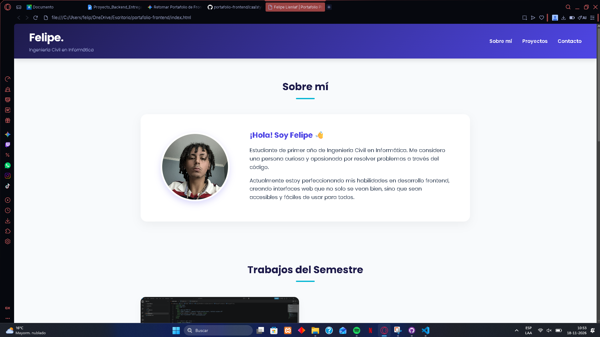

# Portafolio Profesional Web — Evaluación N°4 (PIF)

**Asignatura:** Desarrollo de Frontend (`ICINF1107`) — Ingeniería Civil en Informática, Universidad Católica de Temuco  
**Estudiante:** Felipe Lienlaf  
**Docente:** Cristian Iglesias Vera  

---

## 1. Descripción y Fidelidad al Diseño de la Evaluación 2

Este proyecto corresponde a la migración del portafolio personal desarrollado en la **Evaluación N°2** (HTML5 y CSS3 estático) hacia una aplicación SPA modular construida con **React 19, TypeScript y React Router**.

### Comparación con la Evaluación 2


### Decisiones de diseño conservadas y mejoras justificadas
- **Identidad visual conservada:** Se mantuvieron intactas la tipografía (`Poppins`), la paleta cromática (`#1e1b4b` azul noche, `#4f46e5` índigo, `#06b6d4` turquesa y `#f8fafc` fondo claro), el degradado de cabecera, la fotografía circular de perfil y el estilo de tarjetas con elevación al pasar el cursor.
- **Corrección de selector CSS:** En la hoja de estilos de la E2 existía un error tipográfico en el reset inicial (`-` en lugar de `*`), corregido a `* { box-sizing: border-box; margin: 0; padding: 0; }`.
- **Navegación multipágina con React Router:** Se reemplazaron los enlaces con anclas (`#sobre-mi`, `#trabajos`, `#contacto`) por rutas reales (`/`, `/proyectos`, `/contacto` y ruta `*` para 404), manteniendo el enlace al inicio en el logotipo y marcando la ruta activa con `NavLink`.
- **Modo oscuro transversal (Context API):** Se incorporó `ThemeContext` para alternar entre tema claro y oscuro con persistencia en `localStorage`, evitando prop drilling entre `Header` y la raíz del documento.

---

## 2. Instalación y Ejecución Local

### Requisitos previos
- Node.js 18 o superior
- npm 9 o superior

### Pasos de ejecución
```bash
# 1. Clonar el repositorio
git clone [https://github.com/felipelienlaf/evaluacion_4-felipe_lienlaf.git](https://github.com/felipelienlaf/evaluacion_4-felipe_lienlaf.git)
cd evaluacion_4-felipe_lienlaf

# 2. Instalar dependencias
npm install

# 3. Levantar servidor de desarrollo
npm run dev

# 4. Compilar versión de producción (opcional)
npm run build
```

---

## 3. Documentación de la API Pública Consumida

El portafolio consume la **API REST pública de GitHub** desde el hook personalizado `src/hooks/useGithubRepos.ts` utilizando `fetch` dentro de `useEffect`, control de cancelación con `AbortController` (para evitar condiciones de carrera) y caché en memoria por sesión.

- **Endpoint:** `GET https://api.github.com/users/felipelienlaf/repos?sort=updated&per_page=6`
- **Cabecera enviada:** `Accept: application/vnd.github+json`
- **Justificación de elección:** Permite mostrar de forma dinámica y actualizada los repositorios reales de mi cuenta de GitHub junto al proyecto destacado de la Evaluación 2.

### Contrato de respuesta tipado (`GithubRepo`)
```typescript
export interface GithubRepo {
  id: number;
  name: string;
  description: string | null;
  html_url: string;
  language: string | null;
  stargazers_count: number;
  updated_at: string;
  fork: boolean;
}
```

### Estados manejados en la interfaz
1. **Cargando (`loading === true`):** Muestra un indicador visual con `role="status"` y `aria-live="polite"`.
2. **Éxito (`repos.length > 0`):** Renderiza las tarjetas tipadas mediante el componente `GithubRepoCard`.
3. **Error (`error !== null`):** Informa el motivo al usuario (límite de tasa HTTP 403, usuario no encontrado HTTP 404 o fallo de red) con un botón de reintento (`refetch`).

---

## 4. Revisión de Accesibilidad y Responsividad (Lighthouse)

Se realizó una auditoría mediante **Chrome DevTools Lighthouse** (modo escritorio y móvil) verificando:
- **HTML semántico:** Uso de `<header>`, `<nav>`, `<main>`, `<section>`, `<article>` y `<footer>`.
- **Formularios accesibles:** Cada `<input>` y `<textarea>` cuenta con su `<label htmlFor="...">` asociado, atributos `aria-invalid`, `aria-describedby` y mensajes de error con `role="alert"`.
- **Navegación por teclado:** Foco visible (`outline: 3px solid var(--accent-color)` con `:focus-visible`) y menú móvil accesible con `aria-expanded` y `aria-controls`.
- **Resultados obtenidos en Lighthouse:**
  - **Accesibilidad:** 100 / 100
  - **Buenas prácticas:** 100 / 100
  - **SEO:** 91 / 100